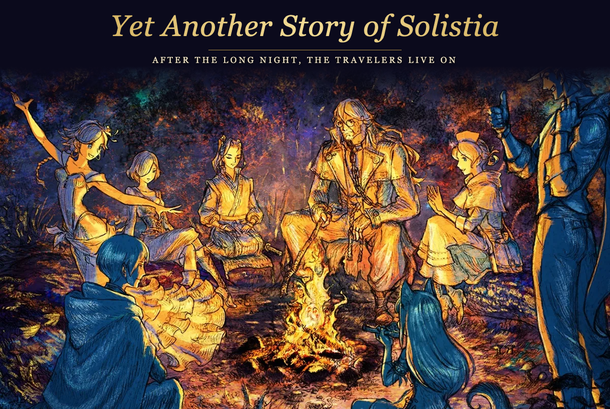
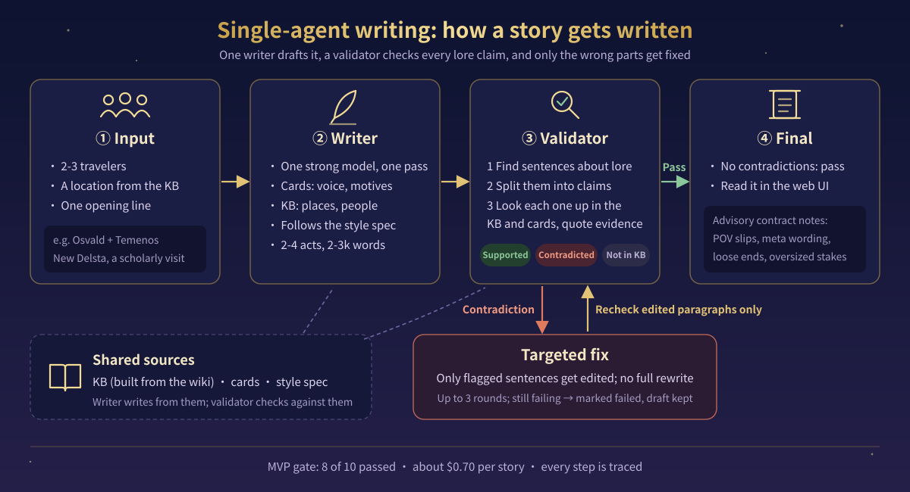

<p align="center">
  
</p>

<p align="center"><b>English</b> · <a href="README.zh-CN.md">中文</a></p>

# Yet Another Story of Solistia

**Yet Another Story of Solistia** picks up where *Octopath Traveler II* leaves off. It runs the continent as a persistent, day-by-day world simulation—laying bare everything that happens and why, while letting you ask: **what if?**

Vide has fallen, and the eight travelers' main journeys have come to a close, yet their lives go on. Every piece of lore in this project is grounded in a single knowledge base curated from the game's Fandom wiki.

## What it does

- **World simulation (the main track):** Each traveler is driven by an independent agent acting on its own goals and memories. A World agent arbitrates whether their actions succeed, plays every NPC, and advances the clock. There is no scripted plot—every change is recorded in an append-only event log, so the world can always pick up the next day right where it left off.
- **Crossroads (in progress):** Slip an unexpected variable into the world from the shadows and watch how it ripples out. Everything that unfolds is organized into **threads**, traceable from root cause to resolution—right down to what each character was privately thinking.
- **Standalone story generation (done):** Pick 2–3 travelers, a location, and an opening hook. A single model drafts a 2,000–3,000-word short story, which a validator then fact-checks sentence by sentence against the lore.

Our original plan was to simulate the world first and then adapt interesting episodes from the logs into prose stories. In a blind head-to-head eval, however, directly written stories beat simulation-derived stories **10–0**. So we let a dedicated writer handle prose, and freed the world simulation from competing on literary style. Instead, the simulation focuses on what a static story cannot do: **maintain a complete causal record, expose every character's private motives, and let you change something and re-run history.**

## Building the knowledge base

<p align="center"></p>

All lore is sourced from the [Octopath Traveler Fandom wiki](https://octopathtraveler.fandom.com/). The full wiki spans roughly 4,700 pages across the entire franchise, of which *Octopath Traveler II* is only a subset. We used Antigravity to distil it in three strict stages, each doing one thing well:

1. **Pull:** Scan every page for OT2 relevance and save the 646 matching pages verbatim.
2. **Polish:** Strip out combat stats, walkthroughs, and other games' entries; normalize formatting; and organize what remains into characters, locations, world lore, and storylines—yielding 514 clean Markdown files. This stage follows a strict **delete-only, never-add** rule, verified against the raw text from step 1.
3. **Link:** Rewrite internal wiki links into relative Markdown paths inside the knowledge base, and flatten links pointing outside the KB into plain text.

Each stage is paired with automated check scripts that Claude re-runs to catch missing pages, empty files, misclassifications, or any hallucinated details not present in the source. All eight protagonists' files were personally reviewed by the author.

The knowledge base is the single source of truth for canon: when a fact is wrong, we fix the KB rather than patching prompts. There is no vector database (no RAG)—agents navigate and read Markdown files directly by path, name, and internal links, with every read recorded in the execution trace. What happens to the travelers *after* the main game isn't on the wiki; that lives in the world premise and character cards.

## How a story is written

<p align="center"></p>

You start with 2–3 travelers, a location, and a brief premise—for example: *"Osvald and Temenos, New Delsta, Osvald comes to town on scholarly business."*

The **Writer** (a frontier model) first reads the travelers' character cards to internalize their personalities, voices, and post-game goals. It then consults the knowledge base for local lore and NPCs, and drafts the complete story in a single pass following a strict style specification: 2–4 acts, 2,000–3,000 words.

Next, the **Validator** reviews the draft from top to bottom. It extracts every sentence that touches game lore, decomposes them into atomic claims (e.g., *"Temenos is an inquisitor"*), and searches the knowledge base, world premise, and character cards for verbatim evidence. Each claim is labeled *supported*, *contradicted*, or *unlisted*. Newly invented minor NPCs, obvious jokes, and things a character misremembers in-universe are not flagged as errors.

When a contradiction is caught, the Writer **patches only the offending sentences**, and the Validator re-checks only the modified paragraphs, for up to three rounds. If a draft still fails after three rounds, the run is marked failed—preserving the draft and full trace for inspection rather than rewriting from scratch. Passing stories can be read in the local web UI, accompanied by advisory "story contract" notes at the end that flag POV slips, anachronistic phrasing, dangling threads, or stakes too grand for a short story.

## Sample stories

Four sample stories generated by the engine, all passing lore validation:

| Story | Travelers | Location |
|---|---|---|
| [The Peculiar Librarian](stories/the_peculiar_librarian.md) | Osvald & Temenos | Montwise |
| [Red Dust Fever](stories/red_dust_fever.md) | Castti & Partitio | Crackridge |
| [The Taste of Raspberries](stories/the_taste_of_raspberries.md) | Agnea & Throné | Cropdale |
| [The Measure of a Mountain](stories/the_measure_of_a_mountain.md) | Osvald & Partitio | the Wildlands |

## How the world runs

<p align="center"></p>

Running `world new` initializes a persistent world from the same basic inputs—setting everyone's starting location, goals, and existing commitments, while seeding a few time-sensitive local matters (a scheduled performance, a brewing dispute, a promised meeting). From then on, each `world run` advances the simulation by one day.

Every day is divided into four time slots—**morning, afternoon, evening, and night**—and each slot steps through four phases:

1. **Plan:** Each traveler privately decides where to go and what to attempt. They might simply linger somewhere or set out to tackle an urgent matter. A plan is purely internal intention; no other character can see it.
2. **Meet:** The engine moves travelers according to their plans, and the World agent announces who else is present at each spot. Whenever two travelers cross paths—or someone sets out to take action—a **scene** begins.
3. **Play:** A scene unfolds turn by turn, with only one character speaking or acting per round. Whoever was just addressed gets the floor first, though anyone with urgent business can cut in. The World agent roleplays all minor NPCs present and adjudicates the outcome of every action.
4. **Off-screen:** In an isolated session, the World agent keeps the rest of the town moving beyond the camera: NPCs go about their routines, and neglected matters expire when their deadlines pass. This off-screen session has no visibility into the travelers and cannot directly touch them.

At day's end, each traveler distills the day's events into a personal memory entry to carry forward. The next morning, travelers update their goals based on yesterday's memories, and the World introduces fresh local developments.

Every state transition in the world—someone moving, making a promise, or advancing a local matter—is recorded in the event log as a strictly typed operation. The world's live state is derived deterministically by replaying this log step by step; narrative flavor text alone never mutates state. The event log is the world's indisputable canon, which is what allows a simulation to run indefinitely across days.

A world continues day after day until all active matters are resolved or it hits its configured day limit. At the close of each simulated day, a Judge agent audits that day's log for lore violations or internal contradictions.

## Theater mode (paused)

<p align="center"></p>

<p align="center"></p>

Every encounter and conversation captured in the event log can be staged and played back like a visual novel in Theater mode.

**What's built:** The engine slices the event log into individual scenes, hangs a backdrop matching the location and time of day, and blocks out stage positions for everyone present. Active speakers turn toward whoever they are addressing while onlookers turn toward the speaker. Dialogue plays out in paged speech bubbles with synthesized voice acting, streaming scene after scene, day by day. The public deployment uses 100% original artwork and locally synthesized audio: 20 character sprites with four directional facings each, over a dozen day/night backdrops, and voice lines generated locally via Kokoro. Two full worlds are live now.

**What we considered adding next:** Stage entrance/exit animations and speaking gestures; a showcase world simulated end-to-end specifically for theater playback; a wider voice palette for minor NPCs.

**Why it's paused:** Fundamentally, Theater mode and the standalone Writer serve the same purpose—delivering a finished story to a passive audience. At that job, the Writer already won 10–0, and layering on more sprites and animations wouldn't fundamentally change the equation. What makes the world simulation special is precisely what linear prose cannot offer: **a transparent causal graph, visibility into hidden character motives, and the freedom to alter events and replay history.** Rather than competing as a standalone medium, Theater mode stays as it is and now serves as an embedded scene player for Crossroads—every scene in a thread links straight to the theater.

### [Online theater](https://solistia-theater.vercel.app)
- **[The Cropdale Festival](https://solistia-theater.vercel.app/world/20261107-180443-2fc52f/theater.html):** Agnea & Throné, 23 scenes
- **[The Oresrush Wilds](https://solistia-theater.vercel.app/world/20261107-200913-754a8c/theater.html):** Hikari & Ochette, 21 scenes

## Crossroads: the unseen hand

<p align="center"></p>

From the shadows, you slip a small perturbation into the world: a missing heirloom, a stranger arriving in town, a rumor making the rounds. The next morning, it takes effect. No one in the world knows whose hand set it in motion. Travelers and townsfolk alike react according to their own natures—and where the butterfly effect leads, no one can predict, not even you.

To make sense of how everything unfolds, Crossroads organizes the world's history into **threads**:

- **One thread per matter:** Every time-bound situation (a festival performance, local trouble, a public accusation) forms its own thread—showing how it started, who is involved, who stands in the way, whose goals are at stake, and when the deadline falls, followed by a chronological feed of every scene and off-screen move until the matter is settled or abandoned.
- **Private motives on display:** Expand any scene to inspect not just what each character said and did aloud, but the private intention behind every single line.
- **No guaranteed outcomes:** Every new world opens with a genuine antagonist blocking a traveler's path. When an opponent pushes back, nothing is automatic: the World agent estimates the odds, and engine code rolls the dice. A failed roll doesn't halt the scene—it bends the story in a new direction, drawing conflicts out across days.

**Current progress:** The threads chronicle view, dice-roll resolution, and opening antagonists are all in place. Next up is the player intervention hook (slipping an event into the world), followed by time-travel branching—rewinding to a past day, changing one variable, and running an alternate timeline.

## Project status

A personal side project under active development.

- **Foundation & story generation (done):** Curated knowledge base; Writer, lore Validator, and targeted patch loop; evaluation harness and 10-story benchmark suite; local web UI for generation and reading. Passed the MVP quality gate with 8/10 stories clearing all checks ([gate_v1.md](eval/results/gate_v1.md)).
- **World engine (done):** World initialization, Traveler and World agents, turn-based scene execution, and deterministic state projection from the event log. Single-day world metrics pass ([world_we_v1.md](eval/results/world_we_v1.md)), and both showcase worlds completed full five-day runs cleanly.
- **Scene player & theater (paused):** Complete with voice synthesis; two full worlds are deployed live (see [Online theater](#online-theater)). Feature-frozen as focus shifts to Crossroads.
- **Crossroads (in progress):** Thread chronicle UI is built; log events tag their parent threads; contested actions carry probabilities and can fail on dice rolls; worlds initialize with real opposition blocking the protagonists.
- **Up next:** Player intervention—drop a new incident into a running world and watch how the cast responds.

## Quick start

Requires Python 3.12+, [uv](https://docs.astral.sh/uv/), and an Anthropic API key configured in `.env` (`ANTHROPIC_API_KEY=...`).

```bash
uv sync
uv run story-engine --help

# Launch the local web UI: /worlds lists simulations, / reads validated stories, /new generates a story
uv run story-engine web          # http://127.0.0.1:8000

# Generate a standalone story from the CLI (write → validate → patch)
uv run story-engine generate --mode baseline --characters osvald,temenos \
  --location new_delsta --scenario "Osvald comes to town on scholarly business"

# Initialize a new world and simulate Day 1 (world simulation only, no prose story)
uv run story-engine world new --characters agnea,throne --location cropdale \
  --situation "Agnea has brought Throné to a festival here."
uv run story-engine world run <world_id> --stop-after day

# Inspect the world's event threads
#   http://127.0.0.1:8000/world/<world_id>/chronicle

# Synthesize voice lines and watch the world play out in Theater mode
uv run story-engine world voice <world_id>
#   http://127.0.0.1:8000/world/<world_id>/theater

# Export a standalone static site with original art and local Kokoro voices
uv run story-engine world voice <world_id> --engine kokoro
uv run story-engine world export <world_id> --assets assets/original --out output/site

# Run unit tests (no LLM calls, zero cost)
uv run pytest tests/unit
```

> **Cost note:** Running live agents consumes API tokens. At standard list prices, generating a standalone story costs roughly $0.70, and simulating one full day in a world costs about $5–7. You can configure the per-run spending circuit breaker via `max_cost_usd` in `config/settings.yaml`.

## Repository layout

| Path | Description |
|---|---|
| `src/story_engine/` | CLI entrypoints, agent implementations, world state model, simulation loop, local web UI, and eval harness |
| `stories/` | Sample stories that passed lore validation (English originals and Chinese translations) |
| `prompts/`, `cards/` | Agent system prompts and character cards for the eight travelers |
| `kb/` | The knowledge base: 514 curated Markdown files distilled from the wiki |
| `preprocess/` | Prompts and audit reports for the three-stage KB build pipeline |
| `assets/original/` | Original character sprites and background art used on the public theater site |
| `config/` | Model assignments per agent role, plus runtime tunables (scene round caps, cost limits, etc.) |
| `eval/` | Fixed judge prompts, benchmark test suite, and evaluation reports |
| `docs/` | PRD, architecture specs, Agent SDK patterns, roadmap, and development history |
| `tests/` | Unit tests (mocked SDK) and live end-to-end (`e2e`) tests |

## Disclaimer

This is an unofficial fan project and is neither affiliated with nor endorsed by Square Enix. *Octopath Traveler* and all related names are registered trademarks of Square Enix. The knowledge base is derived from the [Octopath Traveler Fandom wiki](https://octopathtraveler.fandom.com/) under the [CC BY-SA 3.0](https://creativecommons.org/licenses/by-sa/3.0/) license. The banner illustration uses official *Octopath Traveler II* promotional artwork (© Square Enix) with only a title overlay added; it will be removed immediately upon request by the rights holder.
