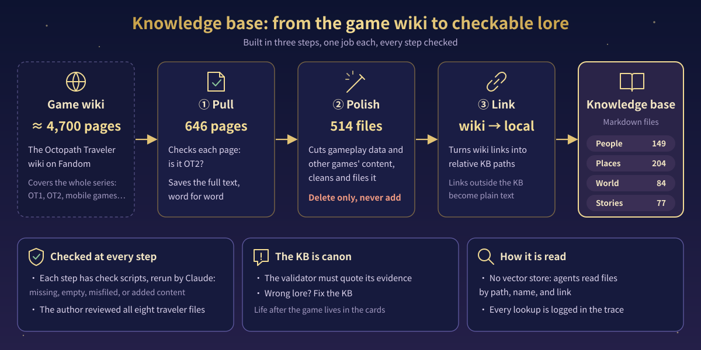
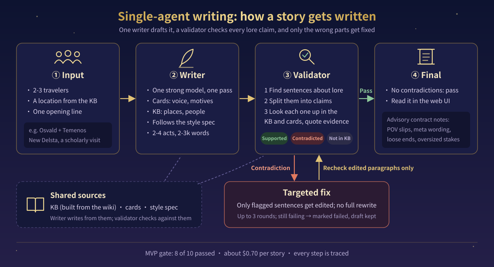
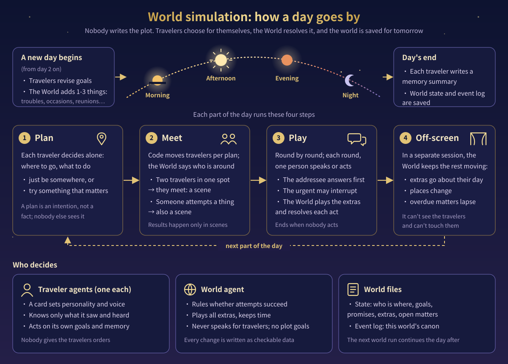
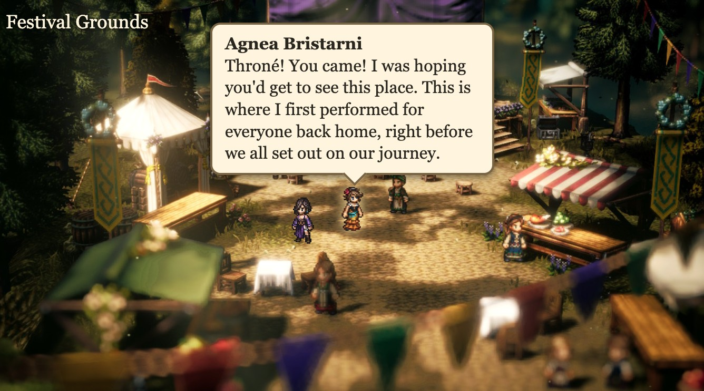

<p align="center">
  
</p>

<p align="center"><b>English</b> · <a href="README.zh-CN.md">中文</a></p>

# Yet Another Story of Solistia

**Yet Another Story of Solistia** is about what happens in *Octopath Traveler II* after the game's story ends. It writes short stories, and it can also keep a world going, one day at a time.

Vide is defeated, and the eight travelers' journeys have come to an end, but their lives go on. Whether it is writing a story or running the world, all the lore comes from one knowledge base built from the game's wiki.

## Two tracks

The project has two tracks:

- **Story generation:** pick 2-3 travelers and a location, give an opening line, and a model writes a 2,000-3,000-word short story. A validator then checks the lore, and anything wrong gets fixed. One click in the local web UI writes a story, and you can read it there too.
- **World simulation:** each traveler is played by an agent that acts on its own goals and memory. A World agent decides whether what they try succeeds, plays everyone else, and keeps time. Nobody plans the plot. Everything that happens goes into an event log, and the world can pick up the next day where it left off.

The original idea was to run the world first, then pick episodes from it to write up as stories. But in a head-to-head test, the directly written stories won 10-0. So now a writer handles stories, the world develops on its own, and it is measured by its own metrics. The two tracks will meet again later.

## Where the knowledge base comes from

<p align="center"></p>

The knowledge base comes from the [Octopath Traveler Fandom wiki](https://octopathtraveler.fandom.com/). The wiki has about 4,700 pages and covers the whole series, of which OT2 is only a part. Antigravity built it in three steps, each with one job:

1. **Pull:** check every page for OT2 content, and save the 646 relevant pages exactly as they are.
2. **Polish:** cut combat data, gameplay guides, and other games' content, clean up the format, and sort what's left into people, places, world, and stories: 514 Markdown files in the end. This step **may only delete, never add**, and the result is checked against step 1's text.
3. **Link:** turn wiki links into paths inside the knowledge base. Links to pages outside it become plain text.

Every step comes with check scripts, which Claude reruns to look for missing pages, empty pages, misfiled pages, or anything the original text doesn't say. The author went through all eight travelers' files personally.

The knowledge base is the authority on lore: when a fact is wrong, the fix goes into the knowledge base, not into a prompt. There is no vector store. Agents read files directly by path, name, and link, and every read is logged in the trace. How the travelers are doing after the game isn't in the knowledge base; that lives in the world premise and the character cards.

## How a story gets written

<p align="center"></p>

You start with 2-3 travelers, a location, and an opening line, for example "Osvald and Temenos, New Delsta, Osvald comes to town on scholarly business."

The **writer** is one strong model. It reads the travelers' character cards for their personality, way of speaking, and what they want now that the game is over. Then it looks up places and people in the knowledge base and writes the whole story in one go, following the style spec: 2-4 acts, 2,000-3,000 words.

Then the **validator** goes through it from the top. It picks out the sentences that touch game lore, breaks them into individual claims (say, "Temenos is an inquisitor"), and looks for quotable evidence in the knowledge base, the world premise, and the character cards. Each claim is judged supported, contradicted, or not in the KB. Newly invented minor characters, jokes, and things a character simply misremembers don't count as errors.

When there's a contradiction, the writer **edits only the sentences at fault**, and the validator rechecks only the edited paragraphs, for up to three rounds. If it still isn't fixed after three, the story is marked failed, with the draft and full trace kept for debugging; it is never rewritten from scratch. Stories that pass can be read in the local web UI, with "story contract" notes at the end pointing out POV slips, wording that breaks the fiction, loose ends, and stakes too big for a short story. The notes are advisory and don't affect whether a story passes.

## Sample stories

Four stories the engine wrote, each passing the validator.

| Story | Travelers | Where |
|---|---|---|
| [The Peculiar Librarian](stories/the_peculiar_librarian.md) | Osvald & Temenos | Montwise |
| [Red Dust Fever](stories/red_dust_fever.md) | Castti & Partitio | Crackridge |
| [The Taste of Raspberries](stories/the_taste_of_raspberries.md) | Agnea & Throné | Cropdale |
| [The Measure of a Mountain](stories/the_measure_of_a_mountain.md) | Osvald & Partitio | the Wildlands |

## How the world runs

<p align="center"></p>

`world new` builds a world from the same inputs: where everyone is, what they want, who they've promised to meet, plus a few small local matters on a deadline, like a performance, some trouble, or a date. After that, each `world run` moves the world forward one day.

A day has four parts: morning, afternoon, evening, and night. Each part goes through four steps:

1. **Plan:** each traveler decides on their own where to go and what to do. They can simply be somewhere, or go and try something that matters. A plan is only an intention, and nobody else sees it.
2. **Meet:** code moves the travelers according to their plans, and the World says who else is at each spot. When two travelers run into each other, or someone sets out to do something, a scene starts.
3. **Play:** the scene goes round by round, and in each round only one person speaks or acts. Whoever was just addressed answers first, and someone with something urgent can cut in. The World plays the minor characters present and decides the outcome of each act.
4. **Off-screen:** in a separate session, the World keeps the rest of the world moving: minor characters go about their business, and matters nobody dealt with lapse when their time runs out. This session can't see the travelers or touch them.

At the end of the day, each traveler writes a memory of the day and carries it into the next. The next morning, travelers adjust their goals from their memories, and the World adds a few new matters.

Every change in the world, such as someone moving, making a promise, or a matter moving forward, is written to the event log as a typed operation. The world's current state is computed from the log step by step, so description alone changes nothing. The log is this world's canon, and that is what lets the world keep going.

## Next (in development)

<p align="center"></p>

The meetings and conversations in the log will one day become scenes you can watch and hear.

Shiny afternoon in a small town. A few familiar figures. A line of dialogue. A voice.

Who, where, and what was said is up to the world.

## Status

A personal project, still in progress.

- **Done:** the knowledge base; the writer, lore validation, and the fix loop; the evaluation kit and 10-story test suite; the local web UI (writing and reading). The MVP gate passed with 8 of 10 stories ([gate_v1.md](eval/results/gate_v1.md)).
- **World engine:** world creation, traveler and World agents, round-by-round scenes, and world state computed from the event log are all built, and the single-day world metrics pass ([world_we_v1.md](eval/results/world_we_v1.md)). Multi-day behavior hasn't been measured yet.
- **Next:** the scene player; see [Next](#next-in-development).

## Quick start

You need Python 3.12+, [uv](https://docs.astral.sh/uv/), and an Anthropic API key in `.env` (`ANTHROPIC_API_KEY=...`).

```bash
uv sync
uv run story-engine --help

# Local web UI: read stories that passed, or write a new one at /new
uv run story-engine web          # http://127.0.0.1:8000

# Write a story from the command line (write → validate → fix)
uv run story-engine generate --mode baseline --characters osvald,temenos \
  --location new_delsta --scenario "Osvald comes to town on scholarly business"

# Build a world and run its first day (world only, no story)
uv run story-engine world new --characters agnea,throne --location cropdale \
  --situation "Agnea has brought Throné to a festival here."
uv run story-engine world run <world_id> --stop-after day

# Tests (unit tests make no model calls)
uv run pytest tests/unit
```

Model calls cost money; one story is about $0.70. Each run's spending cap is `max_cost_usd` in `config/settings.yaml`.

## Layout

| Path | What's there |
|---|---|
| `src/story_engine/` | CLI, agents, world model, simulation loop, local web UI, evaluation tools |
| `stories/` | Sample stories that passed validation |
| `prompts/`, `cards/` | Agent prompts and the eight travelers' character cards |
| `kb/` | The knowledge base: Markdown files built from the wiki |
| `preprocess/` | Prompts and check reports for the three knowledge-base build steps |
| `config/` | Which model each role uses, plus settings such as rounds per scene and the cost cap |
| `eval/` | Fixed judge prompts, the test suite, and evaluation results |
| `docs/` | Requirements, architecture, tech stack, roadmap, and development log |
| `tests/` | Unit tests, and end-to-end tests that call real models |

## Disclaimer

An unofficial fan project, not affiliated with or endorsed by Square Enix. *Octopath Traveler* and all related names are trademarks of Square Enix. The knowledge base is derived from the [Octopath Traveler Fandom wiki](https://octopathtraveler.fandom.com/), whose text is licensed under [CC BY-SA](https://creativecommons.org/licenses/by-sa/3.0/). The cover illustration is official *Octopath Traveler II* promotional art, © Square Enix, with only the title added; it will be taken down immediately if the rights holder asks.
