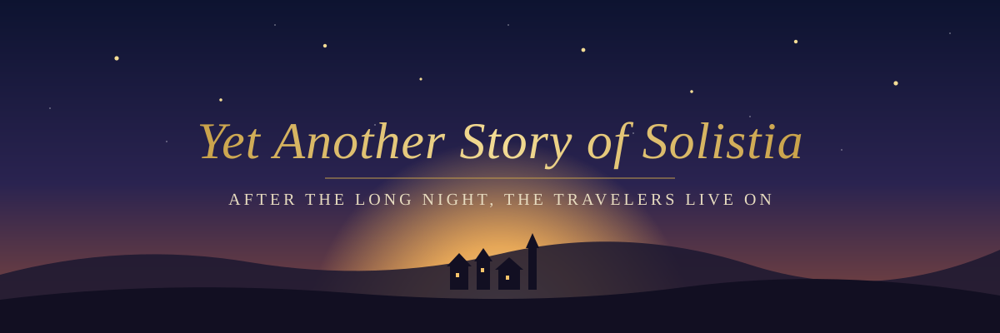

<p align="center">
  
</p>

<p align="center"><a href="README.md">English</a> · <b>中文</b></p>

# Yet Another Story of Solistia

**Yet Another Story of Solistia（又一个 Solistia 的故事）** 模拟《歧路旅人 II》（*Octopath Traveler II*）真结局之后的世界，并从世界里发生的事情中讲出短篇故事。

Vide 已被击败，八位旅人都走完了各自的旅程。在这里，他们继续生活下去。每位旅人由一个独立的 agent 扮演，依据自己的目标和记忆行动。World agent 负责结算他们的尝试、扮演其他所有人，并推进时间。没有人编排剧情。策展人（curator）从一天的事件中挑出值得讲的片段，叙述者（narrator）再把它讲出来，内容以游戏 wiki 构建的知识库为依据。

## 故事如何诞生

```
world new ─► Initializer：从知识库整理场景资料，并建立起始世界状态
              （每个人在哪、目标、约定，以及几件正在倒计时的本地小麻烦）
world run ─► 按时段跑完一天（早上 → 夜晚）
              ├─ 每位旅人决定这个时段做什么
              ├─ World 结算这些选择，并扮演其他所有人
              └─ 旅人相遇的地方，逐轮上演一场戏
           ─► 一天结束：每位旅人写下自己的记忆；世界被保存
           ─► 策展人挑选片段 → 叙述者讲述 → 校验器核对设定
```

世界会持续存在：事件日志就是这个世界的正史，之后的运行会在同一个世界里继续下一天。

`baseline` 模式用同样的起始世界，由一个强模型直接写故事。模拟讲出的故事至少要和 baseline 一样好，这套架构才值得保留。

## 进度

这是个人的、仍在开发中的项目。已完成：知识库、baseline 写手、评测工具、世界创建、角色与 World agent、逐轮场景。进行中：完整模拟一天，之后是策展人、叙述者和设定校验。

## 快速开始

需要：Python 3.12+、[uv](https://docs.astral.sh/uv/)，以及写在 `.env` 里的 Anthropic API key（`ANTHROPIC_API_KEY=...`）。

```bash
uv sync
uv run story-engine --help

# 创建世界，然后模拟第一天
uv run story-engine world new --characters agnea,throne --location cropdale \
  --situation "Agnea has brought Throné to a festival here."
uv run story-engine world run <world_id> --stop-after day

# 用同类输入写一篇 baseline 故事
uv run story-engine generate --mode baseline --characters osvald,temenos \
  --location new_delsta --scenario "Osvald comes to town on scholarly business"

# 测试（单元测试不调用模型）
uv run pytest tests/unit
```

调用模型的命令会产生费用。每次运行的花费上限由 `config/settings.yaml` 里的 `max_cost_usd` 控制。

## 目录

| 路径 | 内容 |
|---|---|
| `src/story_engine/` | CLI、各个 agent、世界模型、模拟循环、评测工具 |
| `prompts/`、`cards/` | agent 的 prompt，以及八位旅人的角色卡 |
| `kb/` | 知识库：由 wiki 整理成的 Markdown 文件 |
| `config/` | 各角色使用的模型，以及场景轮数上限、费用上限等参数 |
| `eval/` | 固定的评审 prompt 和测试集 |
| `tests/` | 单元测试和真实调用模型的端到端测试 |

## 声明

本项目是非官方的同人项目，与 Square Enix 无关，也未获其认可。*Octopath Traveler*（歧路旅人）及相关名称是 Square Enix 的商标。知识库内容源自 [Octopath Traveler Fandom wiki](https://octopathtraveler.fandom.com/)，其文字采用 [CC BY-SA](https://creativecommons.org/licenses/by-sa/3.0/) 许可。横幅图为原创绘制，并非游戏美术素材。
