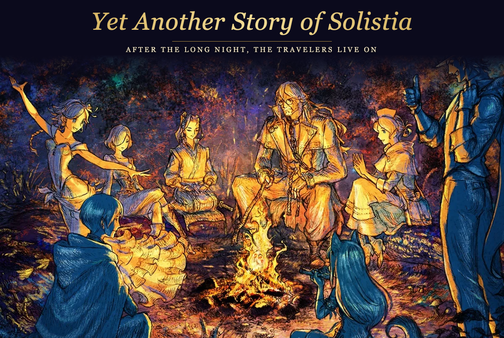
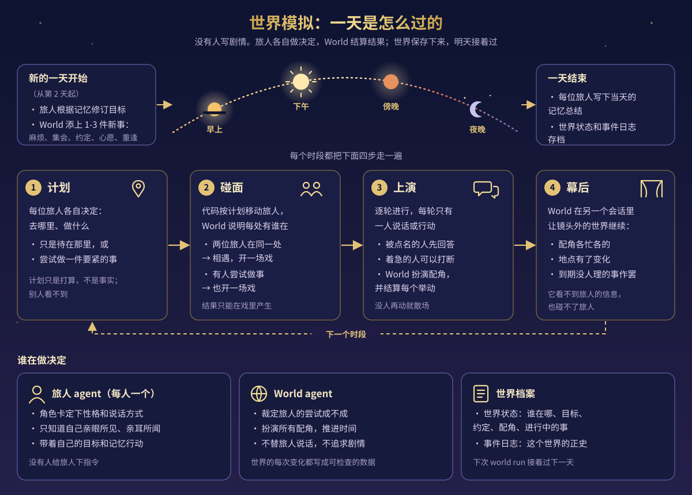
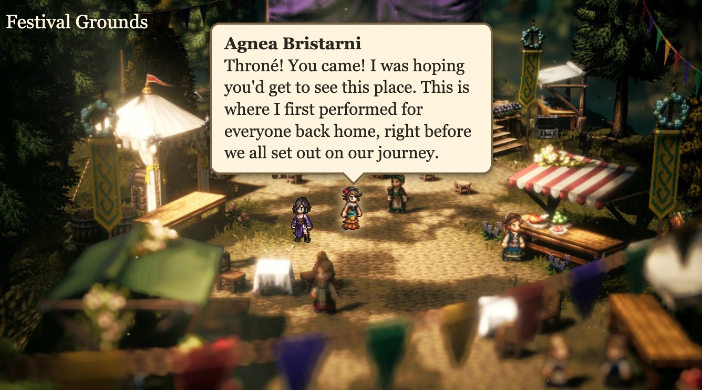
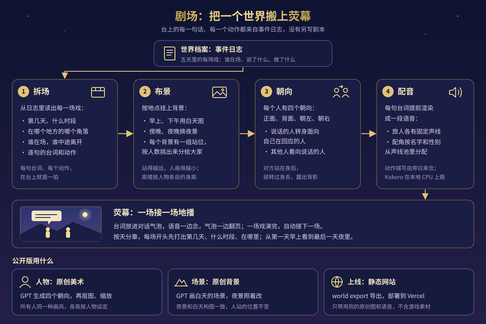

<p align="center">
  
</p>

<p align="center"><a href="README.md">English</a> · <b>中文</b></p>

# Yet Another Story of Solistia

**Yet Another Story of Solistia（又一个 Solistia 的故事）** 讲的是《八方旅人 2》（*Octopath Traveler II*）游戏故事结束以后的事。它让一个世界一天一天地过下去，把发生的每件事和背后的原因都摆给你看，也让你问一句：**如果……会怎样？**

Vide 被打败了，八位旅人的旅程也都告一段落，但他们的日子还在继续。项目用的设定都出自同一个知识库，由游戏 wiki 整理而来。

## 这个项目做什么

- **世界模拟（主线）**：每位旅人由一个 agent 扮演，按自己的目标和记忆行事。World agent 判定他们做的事成不成，扮演其他所有人，还管着时间。剧情没有人安排。世界里发生的每件事都记进事件日志，下次可以接着过下一天。
- **Crossroads 岔路口（正在做）**：你在暗处往世界里放一件事，看它怎么发酵。发生过的一切整理成一条条“事件线”，从起因到结局都能点开看，连角色心里的打算都在。
- **故事生成（已完成）**：选 2-3 位旅人、一个地点，再给一句开场，模型直接写出一篇 2,000-3,000 词的英文短篇，写完由校验器核对设定。

一开始的想法是先跑世界，再从里面挑片段写成故事。可在对比实验里，直接写的故事 10:0 全胜。所以写故事交给写手，世界不再去和写手比文笔，而是做写手做不到的事：留下完整的因果记录，看得到每个人的私心，而且能改了再跑。

## 知识库怎么来的

<p align="center"></p>

知识库来自 [Octopath Traveler Fandom wiki](https://octopathtraveler.fandom.com/)。这个 wiki 有 4,700 页左右，整个系列都在里面，二代只占一部分。整理工作交给 Antigravity，分三步，每步只干一件事：

1. **拉取**：一页页判断是不是二代的内容，把相关的 646 页原样存下来。
2. **精修**：删掉战斗数据、玩法说明和别的作品的内容，理顺格式，按人物、地点、世界观、剧情归类，最后剩下 514 个 Markdown 文件。这一步**只能删，不能加**，改完要和第一步的原文对照。
3. **链接**：把 wiki 链接换成知识库内部的路径。指向库外的链接就改回普通文字。

每一步都配了检查脚本，Claude 会重新跑一遍，看有没有漏页、空页、分错类，或者多出原文里没有的内容。八位旅人的文件由作者本人逐个看过。

设定以知识库为准，发现错误就直接改知识库，不靠改 prompt 去补。项目没有用向量库，agent 按路径、名字和链接直接读文件，每次读了什么都记在 trace 里。旅人在游戏结束后过得怎么样，知识库里没有，写在世界设定和角色卡里。

## 故事怎么写出来的

<p align="center"></p>

先给出 2-3 位旅人、一个地点和一句开场，比如「Osvald 和 Temenos，新德尔斯塔，Osvald 为学术上的事进城」。

**写手**用的是一个强模型。它先看这几位旅人的角色卡，了解他们的性格、说话方式和游戏结束后想做什么，再去知识库查地点和人物，然后按风格规范一口气写完。故事分 2-4 幕，2,000-3,000 词，用英文写。

接着**校验器**从头检查一遍。它把涉及游戏设定的句子挑出来，拆成一条条说法（比如「Temenos 是审问官」），再去知识库、世界设定和角色卡里找原文作为证据，每条判成「相符」「矛盾」或「未收录」。新编的小角色、玩笑话、角色自己记错的事，都不算错。

查出矛盾，写手**只改有问题的那几句**，校验器也只复查改动过的段落，最多来回三轮。三轮还没改好，这篇就算失败，草稿和完整的 trace 都留着方便排查，不会整篇重写。通过的故事可以在本地网页上读，文末附一份「故事契约」提示，指出视角跑偏、出戏的用词、没收尾的悬念和超出范围的大事件。这些只是参考，不影响故事过没过。

## 写出来的故事

下面四篇是写手写的，都通过了校验。原文是英文，这里放的是中文译本。

| 故事 | 旅人 | 地点 |
|---|---|---|
| [古怪的图书管理员](stories/the_peculiar_librarian.zh-CN.md)（[英文原文](stories/the_peculiar_librarian.md)） | Osvald、Temenos | Montwise |
| [赤尘热](stories/red_dust_fever.zh-CN.md)（[英文原文](stories/red_dust_fever.md)） | Castti、Partitio | Crackridge |
| [覆盆子的滋味](stories/the_taste_of_raspberries.zh-CN.md)（[英文原文](stories/the_taste_of_raspberries.md)） | Agnea、Throné | Cropdale |
| [丈量大山](stories/the_measure_of_a_mountain.zh-CN.md)（[英文原文](stories/the_measure_of_a_mountain.md)） | Osvald、Partitio | Wildlands |

## 世界怎么运转

<p align="center"></p>

`world new` 用同样的输入建一个世界，定好每个人在哪、想做什么、和谁有约，再放几件有时限的小事，比如一场演出、一个麻烦、一次约会。之后每运行一次 `world run`，世界就过一天。

一天分早上、下午、傍晚、夜晚四个时段，每个时段走四步：

1. **计划**：每位旅人自己决定去哪、做什么。可以只是待在某个地方，也可以去做一件要紧的事。计划只是打算，别人看不到。
2. **碰面**：代码按计划把旅人挪过去，World 告诉大家每个地方还有谁。两位旅人碰上了，或者有人要去办事，就开一场戏。
3. **上演**：戏一轮一轮地进行，每轮只有一个人开口或行动。被叫到的人先回话，有急事的人可以插嘴。在场的配角由 World 来演，每个举动的结果也由它判定。
4. **幕后**：World 另开一个会话，让镜头外的世界接着走：配角各忙各的，到了时限没人管的事就不了了之。这个会话看不到旅人，也动不了旅人。

一天结束，每位旅人写一份当天的记忆，带到第二天。第二天一早，旅人根据记忆调整目标，World 再加几件新的事。

世界里的每个变化，比如有人换了地方、许下约定、事情有了进展，都以固定格式的操作写进事件日志。世界当前的状态是从日志一步步算出来的，光靠描写改变不了什么。日志就是这个世界的正史，世界也因此能一直过下去。

一个世界会一天接一天地过下去。等所有事情都有了着落，或者到了设定的天数，这个世界就结束了。每天结束后，评审会通读当天的日志，检查有没有违背设定、前后矛盾的地方。

## 剧场模式（已暂停）

<p align="center"></p>

<p align="center"></p>

日志里记下的相遇和对话，可以在剧场里一场场播出来。

**做到了哪儿：** 从日志拆出每场戏，按地点和时段挂上背景，给每个人分站位；说话的人转向在回应的人，其他人看向说话的人；台词放进对话气泡，配上语音，一场接一场按天连播。公开版用的全是原创美术：二十个人物各有四个朝向，十几张白天和夜晚的背景，语音用 Kokoro 在本地生成。两个世界已经上线。

**本可以再做什么：** 让人物在台上走进走出、说话时带手势；专门跑一个从头到尾为剧场准备的展示世界；给配角更多声线。

**为什么暂停：** 剧场和写手做的是同一件事，都是把一个成品故事交给观众。在这件事上，写手已经 10:0 赢过，再往剧场上加画面和动作，也很难说清是不是更好。世界真正独有的，是写手给不了的东西：完整的因果记录、每个人的私心，以及能改了再跑。所以剧场停在现在的样子，成了下面事件线的一部分：事件线里每场戏都能一键跳到剧场去看。

### [在线剧场](https://solistia-theater.vercel.app)
- **[Cropdale 的庆典](https://solistia-theater.vercel.app/world/20261107-180443-2fc52f/theater.html)**：Agnea 和 Throné，23 场戏
- **[Oresrush 的荒野](https://solistia-theater.vercel.app/world/20261107-200913-754a8c/theater.html)**：Hikari 和 Ochette，21 场戏

## Crossroads 岔路口：看不见的手

<p align="center"></p>

你在暗处往世界里放进一样东西：一件丢了的东西，一个陌生人，一句传开的流言。第二天一早，它就在世界里发生了。没有人知道是谁动的手。旅人和镇上的人只会照着自己的心思去应对，事情往哪儿走，谁也说不准，包括你。

想看清它怎么发酵，世界会把发生过的一切整理成**事件线**：

- **一件事一条线。** 每件有时限的事（一场演出、一个麻烦、一桩指控）都是一条线：怎么开始、牵涉谁、谁在阻挠、威胁到谁的目标、期限是哪天，再按时间排出它经过的每场戏、每个幕后动作，直到了结或被放下。
- **看得到私心。** 每场戏点开，能看到角色做了什么、说了什么，也能展开每句话背后角色心里的真实打算。
- **不会顺着谁的心意走。** 世界开场就有人真正挡在主角的路上。对手在场时，没有哪件事是十拿九稳的：World 只给出几率，由代码掷骰。失败不会让戏停下，只会让故事拐弯；一场冲突可以拖上好几天。

**现在做到哪儿：** 事件线、掷骰和开场的对手已经做好；“放一件事”是下一步。再往后，还能回到过去的某一天，换一件事，重新跑一遍。

## 进度

个人项目，还在开发中。

- **已完成**：知识库；写手、设定校验和修改流程；评测工具和 10 篇测试集；本地网页（生成和阅读）。MVP 验收已经通过，10 篇里 8 篇合格（[gate_v1.md](eval/results/gate_v1.md)）。
- **世界引擎**：建世界、旅人和 World agent、逐轮演戏、由事件日志推算世界状态，这些都做好了。单日的世界指标已经达标（[world_we_v1.md](eval/results/world_we_v1.md)）。两个测试世界都完整跑了五天，并且正常结束。
- **场景播放器和剧场**：已完成，带语音；两个世界已经上线，见[在线剧场](#在线剧场)。之后暂停，转向 Crossroads。
- **Crossroads（进行中）**：事件线页面已经做好；事件能标明自己属于哪条线；行动有几率，可以失败；世界开场会安排真正挡住主角的对手。
- **下一步**：作者往世界里放一件事，看世界怎么接。

## 快速开始

需要 Python 3.12+、[uv](https://docs.astral.sh/uv/)，并在 `.env` 里填好 Anthropic API key（`ANTHROPIC_API_KEY=...`）。

```bash
uv sync
uv run story-engine --help

# 打开本地网页：/worlds 看所有世界，/ 读已经通过的故事，/new 写一篇新的
uv run story-engine web          # http://127.0.0.1:8000

# 在命令行写一篇故事（写作 → 校验 → 修改）
uv run story-engine generate --mode baseline --characters osvald,temenos \
  --location new_delsta --scenario "Osvald comes to town on scholarly business"

# 建一个世界，跑第一天（只跑世界，不写故事）
uv run story-engine world new --characters agnea,throne --location cropdale \
  --situation "Agnea has brought Throné to a festival here."
uv run story-engine world run <world_id> --stop-after day

# 读这个世界的事件线
#   http://127.0.0.1:8000/world/<world_id>/chronicle

# 给台词配语音，然后在剧场里从头看
uv run story-engine world voice <world_id>
#   http://127.0.0.1:8000/world/<world_id>/theater

# 用原创美术和 Kokoro 语音导出静态网站
uv run story-engine world voice <world_id> --engine kokoro
uv run story-engine world export <world_id> --assets assets/original --out output/site

# 测试（单元测试不调用模型）
uv run pytest tests/unit
```

调用模型要花钱，写一篇故事大约 $0.7，世界每跑一天大约 $5-7（按官方价格计算）。每次运行的花费上限在 `config/settings.yaml` 的 `max_cost_usd` 里设置。

## 目录

| 路径 | 内容 |
|---|---|
| `src/story_engine/` | CLI、各个 agent、世界模型、模拟循环、本地网页、评测工具 |
| `stories/` | 通过校验的故事样本 |
| `prompts/`、`cards/` | agent 的 prompt 和八位旅人的角色卡 |
| `kb/` | 知识库，由 wiki 整理成的 Markdown 文件 |
| `preprocess/` | 搭建知识库三个步骤的 prompt 和检查报告 |
| `assets/original/` | 公开网站用的原创人物和场景 |
| `config/` | 每个角色用什么模型，以及每场戏的轮数上限、花费上限等参数 |
| `eval/` | 固定的评审 prompt、测试集和评测结果 |
| `docs/` | 需求、架构、技术栈、路线图和开发日志 |
| `tests/` | 单元测试，以及真正调用模型的端到端测试 |

## 声明

这是一个非官方的同人项目，与 Square Enix 没有关系，也没有得到其认可。*Octopath Traveler*（八方旅人）及相关名称是 Square Enix 的商标。知识库内容来自 [Octopath Traveler Fandom wiki](https://octopathtraveler.fandom.com/)，文字采用 [CC BY-SA](https://creativecommons.org/licenses/by-sa/3.0/) 许可。封面插画是《八方旅人 2》的官方宣传图，版权归 Square Enix 所有，这里只加了标题；如果权利方要求，会立即撤下。
