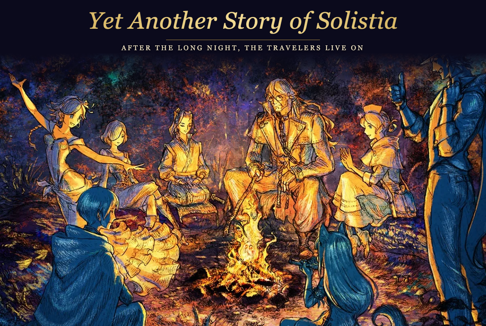
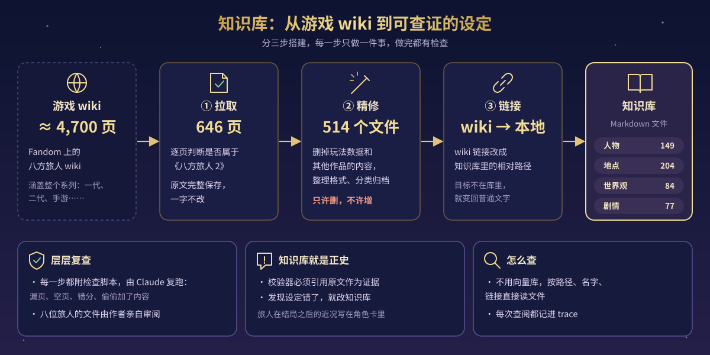
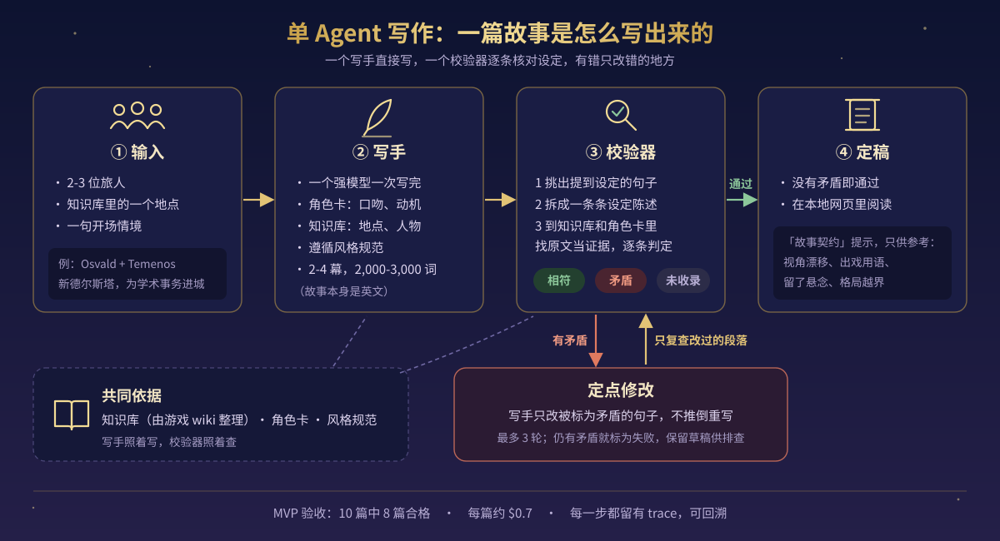
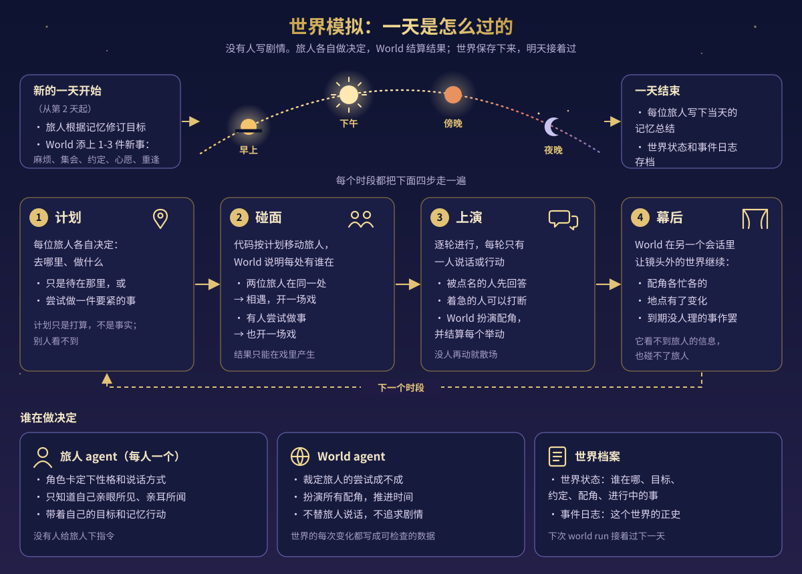
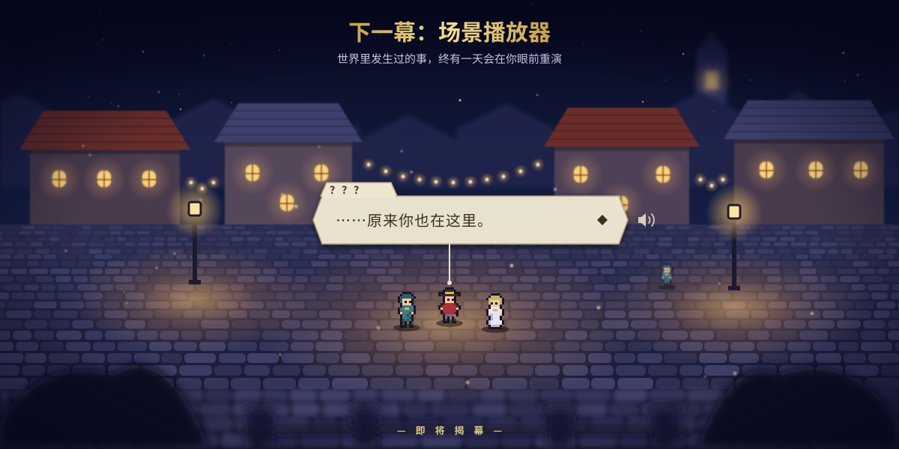

<p align="center">
  
</p>

<p align="center"><a href="README.md">English</a> · <b>中文</b></p>

# Yet Another Story of Solistia

**Yet Another Story of Solistia（又一个 Solistia 的故事）** 讲的是《八方旅人 2》（*Octopath Traveler II*）游戏故事结束以后的事。它能写短篇故事，也能让一个世界一天一天地过下去。

Vide 被打败了，八位旅人的旅程也都告一段落，但他们的日子还在继续。不管是写故事还是跑世界，用的设定都出自同一个知识库，由游戏 wiki 整理而来。

## 两条路线

项目现在分成两条路线：

- **故事生成**：选 2-3 位旅人、一个地点，再给一句开场，模型直接写出一篇 2,000-3,000 词的英文短篇。写完由校验器核对设定，哪里错了改哪里。在本地网页上点一下就能生成，也能直接在网页上读。
- **世界模拟**：每位旅人由一个 agent 扮演，按自己的目标和记忆行事。World agent 判定他们做的事成不成，扮演其他所有人，还管着时间。剧情没有人安排。世界里发生的每件事都记进事件日志，下次可以接着过下一天。

一开始的想法是先跑世界，再从里面挑片段写成故事。可在对比实验里，直接写的故事 10:0 全胜，所以现在写故事交给写手，世界单独发展，用世界自己的指标来衡量。两条路线以后会再合到一起。

## 知识库怎么来的

<p align="center"></p>

知识库来自 [Octopath Traveler Fandom wiki](https://octopathtraveler.fandom.com/)。这个 wiki 有 4,700 页左右，整个系列都在里面，二代只占一部分。整理工作交给 Antigravity，分三步，每步只干一件事：

1. **拉取**：一页页判断是不是二代的内容，把相关的 646 页原样存下来。
2. **精修**：删掉战斗数据、玩法说明和别的作品的内容，理顺格式，按人物、地点、世界观、剧情归类，最后剩下 514 个 Markdown 文件。这一步**只能删，不能加**，改完要和第一步的原文对照。
3. **链接**：把 wiki 链接换成知识库内部的路径。指向库外的链接就改回普通文字。

每一步都配了检查脚本，Claude 会重新跑一遍，看有没有漏页、空页、分错类，或者多出原文里没有的内容。八位旅人的文件由作者本人逐个看过。

设定以知识库为准，发现错误就直接改知识库，不靠改 prompt 去补。项目没有用向量库，agent 按路径、名字和链接直接读文件，每次读了什么都记在 trace 里。旅人在游戏结束后过得怎么样，知识库里没有，写在世界设定和角色卡里。

## 故事怎么写出来的

<p align="center"></p>

先给出 2-3 位旅人、一个地点和一句开场，比如「Osvald 和 Temenos，新德尔斯塔，Osvald 为学术上的事进城」。

**写手**用的是一个强模型。它先看这几位旅人的角色卡，了解他们的性格、说话方式和游戏结束后想做什么，再去知识库查地点和人物，然后按风格规范一口气写完。故事分 2-4 幕，2,000-3,000 词，用英文写。

接着**校验器**从头检查一遍。它把涉及游戏设定的句子挑出来，拆成一条条说法（比如「Temenos 是审问官」），再去知识库、世界设定和角色卡里找原文作为证据，每条判成「相符」「矛盾」或「未收录」。新编的小角色、玩笑话、角色自己记错的事，都不算错。

查出矛盾，写手**只改有问题的那几句**，校验器也只复查改动过的段落，最多来回三轮。三轮还没改好，这篇就算失败，草稿和完整的 trace 都留着方便排查，不会整篇重写。通过的故事可以在本地网页上读，文末附一份「故事契约」提示，指出视角跑偏、出戏的用词、没收尾的悬念和超出范围的大事件。这些只是参考，不影响故事过没过。

## 写出来的故事

下面四篇是写手写的，都通过了校验。原文是英文，这里放的是中文译本。

| 故事 | 旅人 | 地点 |
|---|---|---|
| [古怪的图书管理员](stories/the_peculiar_librarian.zh-CN.md)（[英文原文](stories/the_peculiar_librarian.md)） | Osvald、Temenos | Montwise |
| [赤尘热](stories/red_dust_fever.zh-CN.md)（[英文原文](stories/red_dust_fever.md)） | Castti、Partitio | Crackridge |
| [覆盆子的滋味](stories/the_taste_of_raspberries.zh-CN.md)（[英文原文](stories/the_taste_of_raspberries.md)） | Agnea、Throné | Cropdale |
| [丈量大山](stories/the_measure_of_a_mountain.zh-CN.md)（[英文原文](stories/the_measure_of_a_mountain.md)） | Osvald、Partitio | Wildlands |

## 世界怎么运转

<p align="center"></p>

`world new` 用同样的输入建一个世界，定好每个人在哪、想做什么、和谁有约，再放几件有时限的小事，比如一场演出、一个麻烦、一次约会。之后每运行一次 `world run`，世界就过一天。

一天分早上、下午、傍晚、夜晚四个时段，每个时段走四步：

1. **计划**：每位旅人自己决定去哪、做什么。可以只是待在某个地方，也可以去做一件要紧的事。计划只是打算，别人看不到。
2. **碰面**：代码按计划把旅人挪过去，World 告诉大家每个地方还有谁。两位旅人碰上了，或者有人要去办事，就开一场戏。
3. **上演**：戏一轮一轮地进行，每轮只有一个人开口或行动。被叫到的人先回话，有急事的人可以插嘴。在场的配角由 World 来演，每个举动的结果也由它判定。
4. **幕后**：World 另开一个会话，让镜头外的世界接着走：配角各忙各的，到了时限没人管的事就不了了之。这个会话看不到旅人，也动不了旅人。

一天结束，每位旅人写一份当天的记忆，带到第二天。第二天一早，旅人根据记忆调整目标，World 再加几件新的事。

世界里的每个变化，比如有人换了地方、许下约定、事情有了进展，都以固定格式的操作写进事件日志。世界当前的状态是从日志一步步算出来的，光靠描写改变不了什么。日志就是这个世界的正史，世界也因此能一直过下去。

## 下一幕

<p align="center"></p>

日志里记下的那些相遇和对话，以后会变成能看、能听的场景。

小镇的灯火，几个熟悉的身影，一句台词，一个声音。

是谁，在哪儿，说了什么，就看这个世界自己了。

## 进度

个人项目，还在开发中。

- **已完成**：知识库；写手、设定校验和修改流程；评测工具和 10 篇测试集；本地网页（生成和阅读）。MVP 验收已经通过，10 篇里 8 篇合格（[gate_v1.md](eval/results/gate_v1.md)）。
- **世界引擎**：建世界、旅人和 World agent、逐轮演戏、由事件日志推算世界状态，这些都做好了，单日的世界指标也已达标（[world_we_v1.md](eval/results/world_we_v1.md)）。连续多天的表现还没测。
- **下一步**：场景播放器，见[下一幕](#下一幕)。

## 快速开始

需要 Python 3.12+、[uv](https://docs.astral.sh/uv/)，并在 `.env` 里填好 Anthropic API key（`ANTHROPIC_API_KEY=...`）。

```bash
uv sync
uv run story-engine --help

# 打开本地网页：读已经通过的故事，或者去 /new 写一篇新的
uv run story-engine web          # http://127.0.0.1:8000

# 在命令行写一篇故事（写作 → 校验 → 修改）
uv run story-engine generate --mode baseline --characters osvald,temenos \
  --location new_delsta --scenario "Osvald comes to town on scholarly business"

# 建一个世界，跑第一天（只跑世界，不写故事）
uv run story-engine world new --characters agnea,throne --location cropdale \
  --situation "Agnea has brought Throné to a festival here."
uv run story-engine world run <world_id> --stop-after day

# 测试（单元测试不调用模型）
uv run pytest tests/unit
```

调用模型要花钱，写一篇故事大约 $0.7。每次运行的花费上限在 `config/settings.yaml` 的 `max_cost_usd` 里设置。

## 目录

| 路径 | 内容 |
|---|---|
| `src/story_engine/` | CLI、各个 agent、世界模型、模拟循环、本地网页、评测工具 |
| `stories/` | 通过校验的故事样本 |
| `prompts/`、`cards/` | agent 的 prompt 和八位旅人的角色卡 |
| `kb/` | 知识库，由 wiki 整理成的 Markdown 文件 |
| `preprocess/` | 搭建知识库三个步骤的 prompt 和检查报告 |
| `config/` | 每个角色用什么模型，以及每场戏的轮数上限、花费上限等参数 |
| `eval/` | 固定的评审 prompt、测试集和评测结果 |
| `docs/` | 需求、架构、技术栈、路线图和开发日志 |
| `tests/` | 单元测试，以及真正调用模型的端到端测试 |

## 声明

这是一个非官方的同人项目，与 Square Enix 没有关系，也没有得到其认可。*Octopath Traveler*（八方旅人）及相关名称是 Square Enix 的商标。知识库内容来自 [Octopath Traveler Fandom wiki](https://octopathtraveler.fandom.com/)，文字采用 [CC BY-SA](https://creativecommons.org/licenses/by-sa/3.0/) 许可。封面插画是《八方旅人 2》的官方宣传图，版权归 Square Enix 所有，这里只加了标题；如果权利方要求，会立即撤下。
