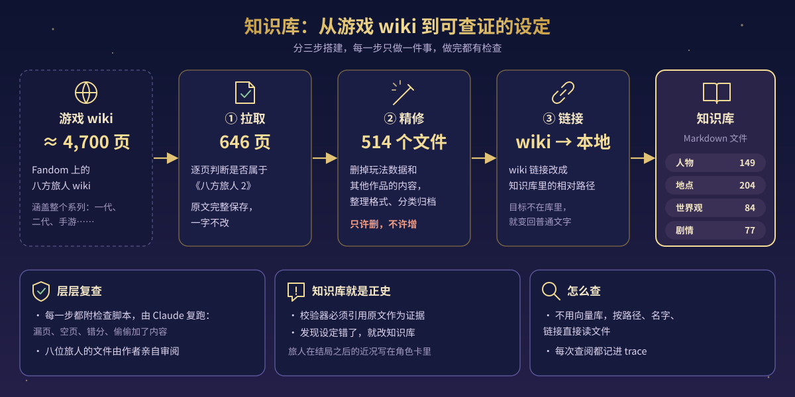
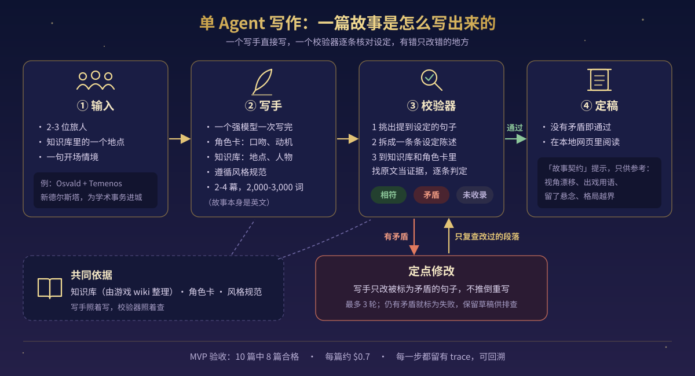
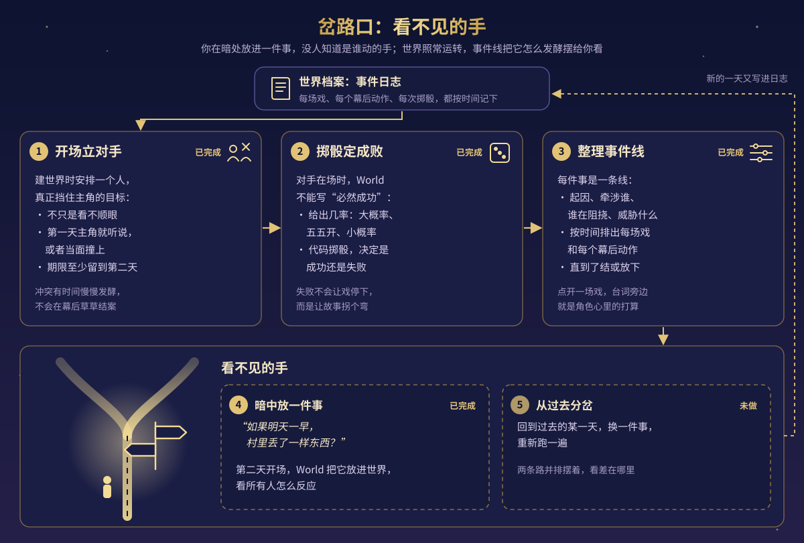

<p align="center">
  
</p>

<p align="center"><a href="README.md">English</a> · <b>中文</b></p>

# Yet Another Story of Solistia

**Yet Another Story of Solistia** 讲的是《八方旅人 2》（*Octopath Traveler II*）通关之后的故事。我们把这片大陆做成了一个按天运转的模拟世界——你能看清里面发生的每一件事、摸清背后的来龙去脉，也能随时抛出一句：**“要是当时……会怎么样？”**

邪神 Vide 已经倒下，八位旅人的旅途也各自画上了句号，但日子还得过下去。项目里的所有设定都整理自游戏的 Fandom Wiki，收在同一个知识库里。

## 核心玩法

- **世界模拟（主线）**：每位旅人都由一个独立的 Agent 驱动，带着各自的目标和记忆去行动；另有一个 World Agent 充当“世界本身”，负责判定行动成败、扮演全世界的 NPC，并推进时间。这里没有预设剧本，发生过的一切都会记入事件日志，随时可以接着往后过下一天。
- **Crossroads 岔路口（开发中）**：你可以在暗中往世界里塞个变数，看它能激起什么水花。所有发生过的事都会被串成一条条“事件线”（Thread），从起因到收场都能点开细看，连角色嘴上没说的小心思都一清二楚。
- **单篇故事生成（已完成）**：挑 2-3 位旅人、选个地点，再给句开场白，模型就能直接写出一篇 2,000–3,000 词的英文短篇，写完还会自动核对设定。

最早我们的想法是“先跑世界模拟，再从日志里挑出精彩片段改写成小说”。但在盲测对比里，让模型直接写的故事以 10:0 完胜。既然如此，写小说这件事就干脆交给专门的 Writer；而世界模拟也不再去跟它拼文笔，转而专注做小说做不到的事——**保留完整的因果链、摊开每个角色不为人知的私心，并且允许你随时改写条件、推倒重跑。**

## 知识库是怎么搭起来的

<p align="center"></p>

设定资料取自 [Octopath Traveler Fandom Wiki](https://octopathtraveler.fandom.com/)。整个 Wiki 大约有 4,700 个页面，涵盖了系列所有作品，《八方旅人 2》只是其中一部分。我们用 Antigravity 把清洗工作拆成了三步，每步只专心做好一件事：

1. **拉取（Pull）**：逐页筛查，把跟二代相关的 646 个页面原封不动地存下来。
2. **精修（Polish）**：剔除战斗数值、攻略指南和其他作品的内容，统一排版，按“人物、地点、世界观、剧情”归好类，最终整理出 514 个 Markdown 文件。这一步的铁律是**只删不加**，处理完还会跟第一步的原文做比对。
3. **链接（Link）**：把原本的 Wiki 链接替换成知识库内部的相对路径；如果指向库外，就退化成普通文本。

每一步都配有校验脚本，跑完后 Claude 会复查一遍，抓出漏页、空页、分错类的页面，或是原文里根本没有的“私货”。八位主角的档案则由作者本人逐篇审校过。

在设定上，知识库是唯一的准绳——发现设定错了就直接改知识库，绝不靠在 Prompt 里打补丁来凑合。我们也没用向量数据库（RAG），Agent 直接顺着路径、文件名和内部链接去读 Markdown，每次读了什么都会记进 trace。至于通关之后旅人们过得怎么样，Wiki 里自然没有，这部分写在了世界背景设定（World Premise）和角色卡里。

## 一篇故事是怎么写出来的

<p align="center"></p>

你只需要指定 2-3 位旅人、一个地点和一句开场引子，比如：“Osvald 和 Temenos，新德尔斯塔，Osvald 因学术事务进城”。

**Writer（写手）** 由一个主力大模型担任。它会先读角色卡，摸清这几位旅人的脾气、说话腔调和通关后的近况，再去知识库里查阅当地的风土人情，最后按文风规范一气呵成，写出一篇 2-4 幕、2,000-3,000 词的英文短篇。

写完后，**Validator（校验器）** 会从头到尾审一遍。它会把涉及设定的句子拎出来，拆成一条条具体的事实陈述（比如“Temenos 是审问官”），再去知识库、世界设定和角色卡里翻原文找证据，逐一判定是“相符”、“冲突”还是“未收录”。至于顺手编的路人甲、角色开的玩笑，或者角色自己记岔了的事，都不会被判作设定错误。

一旦抓出设定冲突，Writer **只定点修改出问题的那几句**，Validator 也只复查改过的段落，最多打回三次。如果改了三轮还过不了，这篇就直接算作失败，保留草稿和完整 trace 留作排查，绝不推倒重写。通过校验的故事可以在本地网页里阅读，文末还会附带一份“故事契约”体检报告，标出视角跑偏、出戏的现代词汇、没填上的坑或是格局失控的大事件——这些提示仅供挑刺参考，不影响故事通关。

## 故事样篇

下面四篇都是引擎生成的成品，均已通过设定校验。原作为英文，这里一并提供中文译本：

| 故事 | 旅人 | 地点 |
|---|---|---|
| [古怪的图书管理员](stories/the_peculiar_librarian.zh-CN.md)（[英文原文](stories/the_peculiar_librarian.md)） | Osvald、Temenos | Montwise |
| [赤尘热](stories/red_dust_fever.zh-CN.md)（[英文原文](stories/red_dust_fever.md)） | Castti、Partitio | Crackridge |
| [覆盆子的滋味](stories/the_taste_of_raspberries.zh-CN.md)（[英文原文](stories/the_taste_of_raspberries.md)） | Agnea、Throné | Cropdale |
| [丈量大山](stories/the_measure_of_a_mountain.zh-CN.md)（[英文原文](stories/the_measure_of_a_mountain.md)） | Osvald、Partitio | Wildlands |

## 世界是怎么运转的

<p align="center"></p>

用同样的输入参数跑一次 `world new`，就能初始化一个新世界：定好每个人的初始位置、目标、和谁有约，再随机埋下几件带期限的当地小事（比如一场演出、一桩麻烦，或者一次碰头）。建好之后，每跑一次 `world run`，世界的时间就往前推一天。

一天分为早、午、傍晚、夜四个时段，每个时段都按固定的四步走：

1. **盘算（Plan）**：每位旅人各自决定接下来去哪、干什么。可以只是在某处待着，也可以去办件正事。计划纯属个人心思，其他角色看不见。
2. **碰头（Meet）**：程序按计划把旅人移动到对应地点，World Agent 则通报现场还有哪些人。只要两位旅人撞上了，或者有人打算动手办事，就会触发一场戏（Scene）。
3. **开演（Play）**：一场戏按回合推进，每回合只有一个人说话或行动。刚被搭话的人优先接茬，有急事的人也可以插话。现场的配角全部由 World 扮演，每个动作能不能成也由它拍板。
4. **幕后（Off-screen）**：World 会单开一个独立会话，推演镜头之外的世界——配角们各忙各的，那些到了期限还没人管的事也会自然过期、不了了之。这个幕后会话看不到旅人，也干预不了旅人。

每天落幕时，每位旅人会把这一天的经历总结成记忆，带进第二天。次日清晨，旅人们会根据昨天的记忆调整目标，World 也会视情况添上几桩新事。

世界里的任何变动——谁换了地方、谁许了承诺、哪件事有了进展——都必须写成结构化的操作指令，记入事件日志（Event Log）。世界的当前状态完全由日志一步步回放推算出来；光在对话描写里嘴炮，改不了任何实质状态。这份日志就是这个世界的“正史”，也是世界能一天接一天接续下去的根基。

世界就这样日复一日地跑下去，直到手头的事都有了着落，或者跑满设定的天数为止。每天结束时，还会有一个 Judge Agent 通读当天的日志，排查有没有吃书或前后矛盾的地方。

## 剧场模式（已暂停）

<p align="center"></p>

<p align="center"></p>

日志里记下的每一场相遇与交谈，都可以在剧场模式里像视觉小说一样演出来。

**目前做到了哪一步：** 把日志拆成单场戏，按地点和昼夜换上背景，给登场角色安排好站位；说话的人会自动转向搭话对象，其他人则看向说话者；台词以气泡弹出，配上语音，按天连播。公开部署的版本全部采用原创美术与本地生成的语音——20 个角色各有四个朝向立绘，十几张昼夜场景图，配音则由 Kokoro 在本地合成。目前已有两个世界上线。

**原本还能怎么卷：** 让角色在舞台上走位进出、说话时做小动作；专门从头跑一个为剧场量身定制的展示世界；给配角加上更多音色。

**为什么停了：** 说到底，剧场模式和 Writer 干的是同一件事——把一个讲完的成品故事端给观众看。可在“讲好一个故事”这件事上，Writer 早就以 10:0 赢过了；就算给剧场堆上再多立绘和动作，也很难说它就比纯文本小说更吸引人。世界模拟真正不可替代的价值，恰恰是小说给不了的东西：**完整的因果链条、角色藏在心底的算盘，以及改个条件重跑一遍的自由。** 所以剧场模式就停在目前够用的状态，转而作为下方“事件线”的配套播放器——在事件线里看中哪场戏，点一下就能直接跳进剧场观看。

### [在线剧场](https://solistia-theater.vercel.app)
- **[Cropdale 的庆典](https://solistia-theater.vercel.app/world/20261107-180443-2fc52f/theater.html)**：Agnea 与 Throné，共 23 场戏
- **[Oresrush 的荒野](https://solistia-theater.vercel.app/world/20261107-200913-754a8c/theater.html)**：Hikari 与 Ochette，共 21 场戏

## Crossroads 岔路口：看不见的手

<p align="center"></p>

你可以在暗中往世界里塞一点变数：一件不翼而飞的物品、一个突然造访的外乡人、一则街头巷尾流传的闲话。第二天一早，它就会在世界里炸开。没人知道是谁在背后捣鬼，旅人和镇民只会顺着各自的性子去应对——至于事情最后会滑向何方，谁也拿不准，包括你自己在内。

为了让你看清这颗石子激起的涟漪，系统会把发生过的一切梳理成一条条**事件线（Threads）**：

- **一事一线**：每桩带期限的事件（一场演出、一桩麻烦、一次指控）都独立成线。它怎么起的头、牵扯了谁、谁在从中作梗、妨碍了谁的目标、哪天截止，再到它经历的每一场戏、每一次幕后推进，直到最终解决或泡汤，全都按时间排得明明白白。
- **表里对照**：点开任意一场戏，既能看角色表面上说了什么、做了什么，也能一键展开他们藏在台词背后的真实意图。
- **事与愿违**：世界一开局，就会有真正的对手挡在主角面前。只要对手在场，就没有什么事是十拿九稳的——World Agent 只负责评估胜算，成败交给代码掷骰子。掷败了戏也不会断，只是剧情会拐向另一条岔路，一场交锋往往能拉扯上好几天。

**当前进展：** 事件线视图、掷骰判定和开局对手都已经实装；下一步就是开放“塞入变数”的入口。再往后，你还可以在时间线上倒回过去的某一天，换个变数，重新推演一遍。

## 开发进度

个人业余项目，仍在持续迭代中。

- **基础与故事生成（已完成）**：知识库搭建；Writer、设定校验与定点修改闭环；评测工具与 10 篇基准测试集；本地 Web 界面（支持生成与阅读）。MVP 验收已通过，10 篇测试故事中有 8 篇达标（见 [gate_v1.md](eval/results/gate_v1.md)）。
- **世界引擎（已完成）**：世界初始化、旅人与 World Agent、回合制演出、基于事件日志的状态推算均已跑通。单日模拟指标已达标（见 [world_we_v1.md](eval/results/world_we_v1.md)），两个测试世界均顺利跑满五天并自然收尾。
- **场景播放器与剧场（已暂停）**：功能与配音均已做完，两个演示世界已上线（见[在线剧场](#在线剧场)）。现已冻结功能，重心转向 Crossroads。
- **Crossroads（进行中）**：事件线页面已就绪；事件已支持关联所属主线；行动已引入胜率与掷骰失败机制；开局会自动安排真正能制衡主角的对手。
- **下一步**：开放玩家干预接口——往世界里扔一件事，看世界怎么接招。

## 快速上手

环境要求：Python 3.12+、[uv](https://docs.astral.sh/uv/)，并在项目根目录的 `.env` 文件中配置好 Anthropic API Key（`ANTHROPIC_API_KEY=...`）。

```bash
uv sync
uv run story-engine --help

# 启动本地网页：/worlds 查看所有世界，/ 阅读已通过校验的故事，/new 生成新故事
uv run story-engine web          # http://127.0.0.1:8000

# 在命令行生成一篇故事（写作 → 校验 → 修正）
uv run story-engine generate --mode baseline --characters osvald,temenos \
  --location new_delsta --scenario "Osvald comes to town on scholarly business"

# 新建一个世界并跑完第一天（仅运行世界模拟，不写小说）
uv run story-engine world new --characters agnea,throne --location cropdale \
  --situation "Agnea has brought Throné to a festival here."
uv run story-engine world run <world_id> --stop-after day

# 查看该世界的事件线（Threads）
#   http://127.0.0.1:8000/world/<world_id>/chronicle

# 为台词生成语音，并在剧场模式中从头观看
uv run story-engine world voice <world_id>
#   http://127.0.0.1:8000/world/<world_id>/theater

# 使用原创美术素材与 Kokoro 本地语音，导出可独立部署的静态网站
uv run story-engine world voice <world_id> --engine kokoro
uv run story-engine world export <world_id> --assets assets/original --out output/site

# 运行单元测试（不调模型，不花钱）
uv run pytest tests/unit
```

> **开销提示**：调用大模型需要消耗 Token。按官方定价估算，写一篇短篇故事大约花 $0.7，世界模拟每跑一天大约花 $5–7。单次运行的费用上限可以在 `config/settings.yaml` 的 `max_cost_usd` 中设置。

## 目录结构

| 路径 | 说明 |
|---|---|
| `src/story_engine/` | CLI 入口、各角色 Agent、世界状态模型、模拟主循环、本地 Web 服务与评测工具 |
| `stories/` | 通过设定校验的故事样篇（含英原文与中译） |
| `prompts/`、`cards/` | Agent 系统提示词与八位旅人的角色卡 |
| `kb/` | 知识库（由 Fandom Wiki 清洗整理出的 514 个 Markdown 文件） |
| `preprocess/` | 知识库清洗三步曲的 Prompt 与质检报告 |
| `assets/original/` | 公开展示站使用的原创角色立绘与场景背景 |
| `config/` | 各角色绑定的模型配置，以及单场回合上限、费用上限等运行参数 |
| `eval/` | 固定的评审 Prompt、测试集与历次评测报告 |
| `docs/` | 产品需求、架构设计、技术栈说明、路线图与开发日志 |
| `tests/` | 单元测试，以及会实际调用模型的端到端（E2E）测试 |

## 免责声明

本项目为非官方同人作品，与 Square Enix 无任何关联，亦未获其官方背书。*Octopath Traveler*（八方旅人）及相关名称均为 Square Enix 的注册商标。项目知识库整理自 [Octopath Traveler Fandom Wiki](https://octopathtraveler.fandom.com/)，相关文本内容遵循 [CC BY-SA 3.0](https://creativecommons.org/licenses/by-sa/3.0/) 协议。顶部横幅插画源自《八方旅人 2》官方宣传图（版权归 Square Enix 所有，此处仅叠加了项目标题）；若权利方提出要求，将立即撤下。
